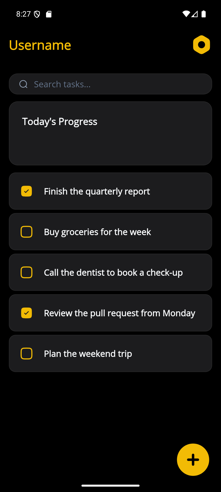
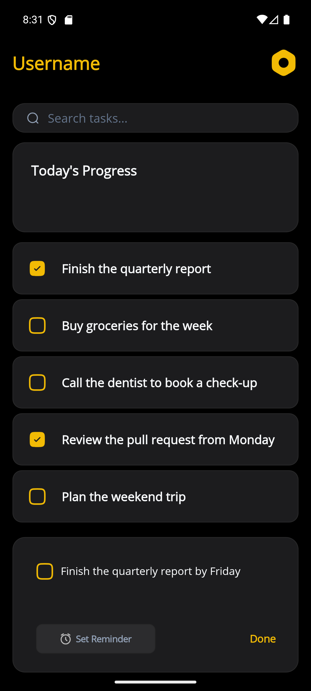
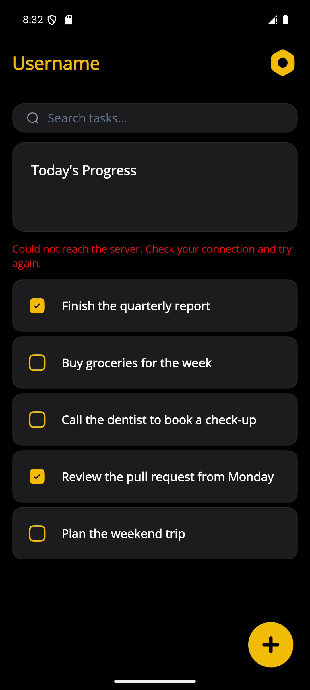
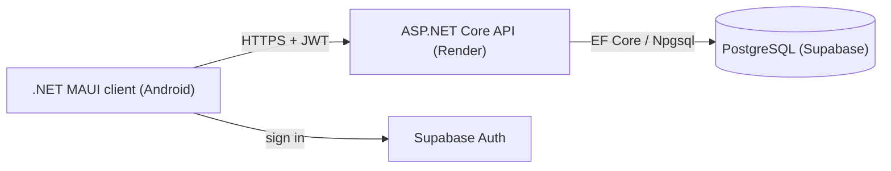
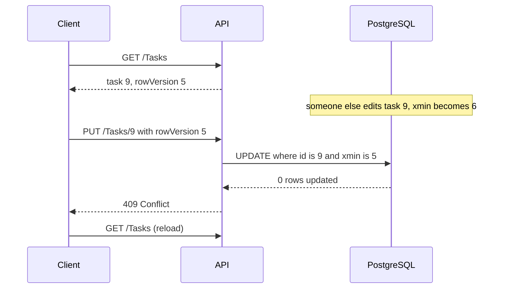

# ToDoApp


An Android task manager with per-user accounts: a **.NET MAUI** client, an **ASP.NET Core** API and **PostgreSQL** on Supabase. I built it to learn how a small system holds together end to end: authentication, authorization, concurrency, error handling, logging, testing, CI/CD and deployment.

> [!NOTE]
> **Work in progress.** The core flow works and is deployed, but the app is not finished. The UI still needs polish (several elements are placeholders), and the backend has planned work: sign-up and password reset, offline support, real-time updates and a proper conflict-resolution flow. See [Status](#status) and [Roadmap](#roadmap).

**Download:** [latest release](https://github.com/AndreiEuseb1u/ToDoApp/releases/latest). It is a signed APK; the install steps and its SHA-256 are in the release notes.

<p align="center">



</p>
<p align="center"><sub>Task list · Edit panel · Server unreachable</sub></p>

## Contents
[Try it](#try-it) · [What it does](#what-it-does) · [How it works](#how-it-works) · [Engineering decisions](#engineering-decisions) · [What went wrong and what it taught me](#what-went-wrong-and-what-it-taught-me) · [Status](#status) · [Tech stack](#tech-stack) · [Testing and CI/CD](#testing-and-cicd) · [Run it locally](#run-it-locally) · [Roadmap](#roadmap)

## Try it

Self-service sign-up is not finished yet, so use this shared demo account:

- Email: `abc@xyz.com`
- Password: `1234`

The account is public and shared: other visitors can see and change its tasks, and the data may be reset at any time. Please do not store anything personal in it.

## What it does

- Sign in with Supabase Auth; the session is kept in secure storage. Sign-up and password reset are still in progress, so a shared demo account is provided.
- Create, edit, complete and delete tasks. Every user only sees their own.
- If a task was changed elsewhere in the meantime, the change is rejected and the app reloads instead of silently overwriting it.
- If the server cannot be reached, the app says so instead of closing.

## How it works



1. The client signs the user in with Supabase Auth and receives a JWT.
2. Every API call carries the token. The API validates it and reads the user id from its claims.
3. Controllers stay thin. A service layer holds the rules and talks to the database through EF Core.
4. Services return a result object instead of throwing, and one small mapper turns it into an HTTP status.

| Endpoint | Purpose |
|---|---|
| `GET /Tasks` | the current user's tasks |
| `POST /Tasks` | create a task (the description only) |
| `PUT /Tasks/{id}` | replace a task's description, completed flag and version |
| `DELETE /Tasks/{id}?rowVersion=n` | delete a task the client has seen at version `n` |

Errors: `400` validation, `401` missing or invalid token, `404` not found (or not yours), `409` the task changed since the client read it.

## Engineering decisions

**The server decides who you are.** The user id comes from the validated token, never from the request. Request DTOs contain only what a client may set: the description on create; the description, the completed flag and the version it saw on update. Fields like `taskItemId` cannot even be sent.

**Other people's tasks look like missing tasks.** Touching someone else's task returns `404`, not `403`, so nobody can learn which ids exist. The attempt is logged as a warning with the user id and task id only.

**Optimistic concurrency.** Each task carries a `RowVersion` mapped to PostgreSQL's `xmin`. The client sends back the version it last saw, the API sets it as the entity's original value, and a mismatch becomes `409`.



**Failures are values, not exceptions.** The API uses a result type with an error category mapped to HTTP statuses. The client mirrors it: every call goes through one wrapper that turns network failures and server errors into a result with a category (`Conflict`, `NotFound`, `NoResponse`, `Unknown`). The view model never sees HTTP codes, and a dropped connection cannot crash the app.

**A conflict does not leave the user stuck.** On `409` or `404` the client reloads the list, rebinds the task being edited to the fresh version and keeps what the user typed. The trade-off is explicit: saving again overwrites the other change without showing it. A "keep mine / take theirs" prompt is planned.

**Logs where they explain something.** Serilog writes to the console, and to Seq when `Seq:ServerUrl` is configured. Every request's logs share a `TraceId`. I only wrote custom logs where the HTTP response cannot tell the story; database failures already reach the logs as unhandled exceptions, so I did not log them twice.

**Configuration stays out of the code.** Secrets come from user secrets or environment variables, and the API refuses to start without a connection string, so a forgotten variable shows up at deploy time and not on the first request. Signing keys are git-ignored. The Dockerfile builds only the API and runs it as a non-root user.

## What went wrong and what it taught me

| What happened | How I found it | What I changed |
|---|---|---|
| The concurrency version never changed | Editing a task in the database and then in the app produced no conflict | The version was a `byte[]`, which Npgsql maps to a plain column; it must be a `uint` bound to `xmin` |
| Conflicts were still not detected | I read the SQL that EF Core generated | EF Core compared against the row it had just loaded; I now set the client's version as the original value |
| `POST` accepted any id | I sent a `taskItemId` by hand and got a primary-key error | Request DTOs, so the field cannot be sent |
| A failed request looked like a dead app | I ran the client against a stopped API, then hit the free-tier cold start | One wrapper with result categories, a loading indicator and a message |
| The first "signed" APK used the debug key | I inspected the certificate and the fingerprint was not mine | I rebuilt with all signing parameters and compared fingerprints |
| My first hosting choice refused new sign-ups | The service page showed an error | The Dockerfile was portable, so moving to Render took one new service |

Common thread: trust boundaries belong in the structure of the code, not in a line someone can delete; failures should be explicit values; and a green test suite does not replace running the thing.

## Status

| Area | State |
|---|---|
| Sign in | Working |
| Sign-up and password reset | In progress |
| Create, edit, complete, delete tasks | Working |
| Conflict detection and recovery | Working; no prompt to choose whose change wins |
| Loading and error feedback | Basic: one indicator and one message |
| Search, reminders, settings, progress card, header greeting | UI placeholders |
| Offline mode | Not started |
| Real-time updates | Not started |

## Tech stack

| Layer | Technology | Role |
|---|---|---|
| Language | C# | the app and the API |
| Mobile app | .NET MAUI (Android) | screens and client-side logic |
| Backend | ASP.NET Core | REST API, validation and rules |
| Database | PostgreSQL (Supabase) | stores the tasks |
| Authentication | Supabase Auth, JWT | sign-in; the API validates the token |
| Delivery | Docker, GitHub Actions | container image; tests and builds on every pull request |
| Hosting | Render | runs the API |

## Testing and CI/CD

- xUnit tests cover the service layer (validation, ownership, success and failure paths) with the EF Core in-memory provider.
- Known gap: that provider has no concurrency tokens, so the `409` path is verified by hand, not by a unit test.
- GitHub Actions builds and tests every pull request. On `main` it also builds the Docker image and publishes it to `ghcr.io`. Changes to `main` go through pull requests.
- Render builds the API from the repository's Dockerfile. The client's Release build points at that deployment; its Debug build points at `10.0.2.2:5246`, the host machine as the Android emulator sees it.
- The Android APK is built and signed by hand and attached to a GitHub release.
- The free Render plan sleeps when idle, so the first request after a while can be slow. The app shows a loading indicator meanwhile.

## Run it locally

Prerequisites: .NET 10 SDK, the MAUI Android workload, an Android emulator and a Supabase project.

1. Clone the repository.
2. In `ToDoApp/MauiProgram.cs`, set your Supabase URL and publishable key.
3. From the `ToDoApp.Api` folder, configure the API with Supabase's **session pooler** connection string:
   ```
   dotnet user-secrets set "ConnectionStrings:Default" "<your connection string>"
   ```
   Optionally `dotnet user-secrets set "Seq:ServerUrl" "http://localhost:5341"` to send logs to a local Seq.
4. Apply the migrations with `dotnet ef database update` (the design-time factory reads `TODOAPP_CONNECTION_STRING`).
5. Run the API (port 5246), then the client in **Debug** on the emulator.
6. Tests: `dotnet test ToDoApp.Api.Tests`.

To run the API as a container: `docker build -t todoapi .`, then
`docker run -p 8080:8080 -e ConnectionStrings__Default="<connection string>" todoapi`.

## Roadmap

**Backend and architecture**
- Offline-first: a local SQLite cache plus a sync queue
- Guest mode that links to an account later
- Real-time updates (Supabase Realtime or SignalR)
- A conflict-resolution prompt; `If-Match` / `ETag` for concurrency checks
- Handling for expired sessions; audience validation on the token
- Rate limiting and a public health endpoint
- Integration test for the concurrency path (SQLite or real PostgreSQL)

**Client and polish**
- Finish sign-up and add password reset
- Real search, reminders, settings and progress card
- Cancel and retry buttons
- Build the MAUI project in CI and the signed APK in CI